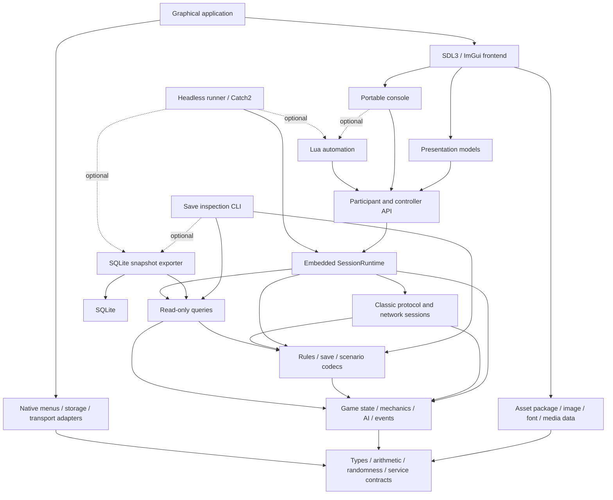

# Architecture

Status: implementation architecture, with an initial application shell integrated.
The [shell implementation](application-shell.md) records the implemented subset;
the libraries and capabilities below are the target design, not a conformance
claim. Delivery status and acceptance gates are in the
[implementation plan](implementation-plan.md).

Build a C++20 game with CMake, SDL3, and Dear ImGui for macOS, Linux, Windows,
and browser WebAssembly through Emscripten. The game implementation, including
AI, persistence, session orchestration, and networking, runs without a graphical
framework. The graphical application, save inspection tools, conformance runner,
and user automation are clients of the same portable implementation. Its logical
client/server boundary is an embedded session service, with participant/controller
bindings and mode-specific execution authority. An in-game console and Lua scripts
use player queries and semantic commands; they do not require implementing the
core algorithms in Lua.

## 1. Cleanroom and compatibility boundary

The behavioral source of truth is this repository's
[algorithm specifications](algorithms/README.md), interpreted under
[X01](algorithms/X01-classic-compatibility-contract.md). The target is Civilization II
Multiplayer Gold Edition **5.4.0f, patch 3**. Architecture decisions cannot weaken
that contract; discrepancies must be resolved in the owning specification.

Implementation rules:

- Write new code from these specifications and their declared input formats.
  Do not read, copy, translate, link, generate from, or otherwise derive game code
  from `openciv2` or the Civ2 decompilation/reconstruction work. This includes
  their renderers, build helpers, tests, and historical execution harnesses.
  External code links, filenames and source-derived harness notes belong only
  in clearly marked validation/provenance sections. They record historical
  research and do not authorize consulting those sources for implementation,
  tests or build integration. Keep implementation catalogs and algorithm prose
  free of source-navigation shortcuts; specify required formats and behavior here.
- Use the original game as an external comparison and interoperability target.
  Independently authored drivers may supply inputs and capture observable state,
  files, packets, and interaction outcomes. Original executable code is never
  linked into the game or its portable tests.
- Record behavioral ambiguities as specification gaps, with the smallest
  affected operation and input domain. Obtain an original-game observation or
  clarify the specification before depending on an invented behavior. Keep
  provisional behavior and restricted prototype domains explicitly labeled.
- Each implemented operation and behavioral test cites its specification ID and
  section. Expected results distinguish specification-derived expectations,
  independent original-game captures, and implementation regression snapshots.
  A snapshot produced by our own implementation does not establish compatibility.
- General-purpose dependencies such as SDL3, ImGui, Catch2, and independent
  codecs are permitted. Record pinned versions and notices. The designated
  `PeterJohnson/openciv2-assets` runtime content is an allowed data dependency;
  its comparison tools and old-game source integration are outside the game build.

Required compatibility includes simulation, classic AI and map generation,
scenario-authored content, bidirectional original save/map/scenario interchange,
hotseat, and original-peer TCP/IP multiplayer with either engine hosting.
Presentation has broad design freedom: preserve game rules, meaningful
information, privacy, accepted commands and actual protocol timing, while loading
original configuration/scenario content and retaining a familiar overall feel.
Exact prompt operation, navigation, sorting, formatting, drawing and native UI
behavior are reference only. IPX, modem and serial remain optional under X01.

F01 permits a new reproducible RNG policy. It does **not** permit changed
sampling laws, AI heuristics, map-generation rules, arithmetic, deterministic
ties, or rerolling a result received from another peer. Classic file/wire formats
must work without new RNG metadata.

### Fresh-game boundary and bug repairs

X01's fresh-game isolation and documented safety repairs override historical
retention and call-order descriptions. Starting a new game is an explicit session
operation before chosen content is loaded, not a menu-rendering callback. Replace
the world, derived/workspace state, mutable rules/text/naming state and file scratch;
preserve only user preferences, application configuration, immutable content caches
and identity generators. Complete/cancel admitted operations and drain required
network output, revoke old clients and discard their queues before replacement.
Load/resume and within-game civilization creation retain their distinct contracts.

`SessionRuntime::prepare_new_game` establishes the implemented boundary;
`enter_new_world` invokes it before rules and setup and resets classic file scratch.
The rule object keeps its address for adapters but its contents are fresh. The
caller supplies the chosen RNG context explicitly; no hidden draw/reseed occurs.
Cold-start and previously used runtimes must produce equivalent gameplay with the
same inputs. Do not require old AI-goal refresh, old free-slot damage or old naming
cursors to initialize a game. References into replaced state are invalidated.

Within a game retain state that affects later decisions, ties, files or messages.
Pure queries have no invented callback/mutation contract. Confirmed invalid-memory
or uninitialized-local behavior uses a documented narrow repair; diagnostic
original-stack cases are not production inputs. Missing behavior remains an owner
gap until resolved from the contract or independent original-game observations.

## Compatibility surfaces in the implementation

X01 and each owner's Production contract scope distinguish game behavior,
external interchange and optional executable comparison. The core owns logical
rules/state and meaningful retained inputs. Format/protocol adapters own external
layouts, opaque imported fields and valid translations. Comparison tools own
original private memory/ABI/native traces; production does not depend on them.
Independent original-game file/peer tests remain required evidence for supported
interchange, separate from optional trace matching.

Architecture choices here (libraries, records, services and APIs) are project
design decisions, not claims that classic compatibility requires those shapes.
Pass operation contexts explicitly; preserve true data flow rather than globals
or aliases. Only real admitted commands/events/responses constrain live reads.
Allocation, drawing, formatting and diagnostic callbacks do not create game
interleavings. Codecs/checksums use defined byte images rather than native structs.
Staged import and atomic output replacement are allowed; accepted game/peer
effects remain committed and all real failures are reported truthfully.

## Production and reference boundary

Production code implements semantic information, choices, authored content and
required game/file/network effects. Original storage addresses, pool ordinals,
allocation extents and padding, heap capacities, handle ownership, widget flags,
private buffers, native-control traces and allocator call order are comparison
details only unless an owning file/wire/resource contract explicitly consumes
them. Do not add them to live state or service interfaces to match a reference
snapshot. Original trace emulation belongs in optional tools/tests which
production targets neither link nor depend on.

Classic adapters remain production code: they translate externally meaningful
indices, encodings and results into the semantic model. For each representation
detail, identify its actual external consumer; compare resolved values or encode
through that adapter. Allocation-failure tests may check resource safety, but
cannot invent gameplay callbacks, per-allocation publication or reentry. Harmless
UI failures do not prescribe original fatal-error timing. This boundary overrides
mixed historical excerpts and stronger storage/trace language below.

### Logical text and classic name markers

Live names use full-width implementation-local references or owned strings and
explicit custom-name flags, never signed 16-bit pool ordinals. UI label rebuilds
must not rebind retained rule names. Reload policies preserve or replace semantic
names/flags; preserved fields need no discarded allocations. Original padding,
last-allocation pointers, minimum extents and heap-size hints are comparison-only.
Empty padded-name input still means one space; ordinary empty classic pooled
input resolves to `<nil>`. These content rules do not require padded storage.

F06 stored leader records retain their exact 48-byte encoding in a separate codec
type. Live loading rebuilds names from chosen rules and consumes saved signs at
the specified stages; saved magnitudes do not index replacement text storage.
Live export writes custom/noncustom markers as -1/+1 independently of local IDs.
Lossless stored-file decode/re-encode preserves original magnitudes, including
zero and -32768. This canonical live encoding follows F06's sign-only restoration
contract; it does not claim equality with original allocation-dependent exports.
Repeated selected-tribe effects retain their specified behavior.

Narrowing a text ID into an unrelated earlier name or an accidental custom-name
marker is a repaired storage defect. Preserve intended names and flags beyond
32767/65535 entries. Reference tools may report original ordinals/aliasing;
production tests assert text, reload behavior, bounds and file-marker semantics.
Unrelated scalar arithmetic and external field widths remain unchanged. This
contract overrides original-storage interpretations elsewhere in this document.

## 2. Dependency structure

Arrows below mean “uses.” Platform implementations fulfill interfaces declared
in the portable libraries; they are selected by the executable, not constructed
by the game.



The participant/controller API belongs to `oc2_session`; it is not another
process or library. Classic AI policies remain engine operations in `oc2_game`,
scheduled by the runtime. The diagram's network dependency does not require
opening a transport for local play.

Use a small number of libraries with internal subsystem directories; the 65
specifications are ownership boundaries, not a requirement for 65 libraries.
Proposed CMake targets:

Currently implemented: `oc2_base`, F02/W01 and U01 stack/deletion primitives in
`oc2_game`, stored codecs
and gameplay content loaders in `oc2_formats`, stored/live projections in `oc2_query`, bounded N05/N02 primitives
in `oc2_network`, initial ownership/client bindings in `oc2_session`, optional
`oc2_export_sqlite`, `oc2_io_native`, `oc2_viewmodel`, `oc2_frontend`, `oc2_options`,
ImGui dependency targets, and application/tool/test executables. The
[M1 audit](m1-validation.md) records the remaining scope. The shell lives in
`src/viewmodel/`; it contains no simulation. Add the remaining targets as their
first real operations arrive. Native menu sources currently compile into
`oc2_frontend` and can split into the listed adapter targets when needed.

| Target | Responsibility and allowed dependencies |
| --- | --- |
| `oc2_base` | Logical IDs, explicit arithmetic, sampling policy, clocks, diagnostics, service contracts; C++ standard library only initially. |
| `oc2_game` | Authoritative C++ runtime records and collections for F02 state, rule model, W/U/C/V mechanics, A01–A08, event execution; depends on `oc2_base`. No database dependency. |
| `oc2_formats` | Native JSON content decoding and classic F03/text/scenario adapters into shared logical models; F06 codecs and classic encoding. Depends on `oc2_game`; no filesystem or GUI calls. |
| `oc2_query` | Read-only projections of decoded records and live state, with explicit access contexts and stable ordering; depends on `oc2_game` and `oc2_formats`. No session loading, recalculation, command dispatch, or presentation types. |
| `oc2_network` | N01–N03/N05 protocol state machines, encoders, synchronization and authority; depends on `oc2_game` and `oc2_formats`, injected transport/time. |
| `oc2_session` | Embedded `SessionRuntime`, participant/controller bindings, scoped client API, mode/authority adapters, F04/F05/N04 orchestration, setup/load flows, AI scheduling, pending interactions, command descriptors/results and P01–P10 gameplay effects; composes game/formats/network/query libraries. |
| `oc2_viewmodel` | Observer-filtered map/dialog/report/menu models and frontend intent mapping through the session client API; uses query value types, never mutable world access. No SDL/ImGui types. |
| `oc2_console` | Command parsing, help/completion and structured output through a participant's session binding; no SDL/ImGui or required scripting runtime. |
| `oc2_automation` | Optional Lua controller bindings, task scheduling and explicit script state through the scoped session API. Core libraries do not depend on Lua. |
| `oc2_content` | Runtime asset package, CPU image/font data, asset identities and lookup; depends on portable types and selected independent decoders. No GPU objects. |
| `oc2_frontend` | SDL window/input/render/audio and ImGui dialogs, custom drawing, map, minimap and console panel; depends on view models, content and console. |
| `oc2_io_native`, `oc2_io_web` | Storage, time and transport implementations. Native headless I/O must not link SDL; web glue stays out of portable libraries. |
| `oc2_menu_macos`, `oc2_menu_windows`, `oc2_menu_imgui` | Implement a shared menu contract; native handles stay in these graphical targets. |
| `openciv2`, `oc2_headless`, `oc2_tests`, `oc2_runtime_tests`, `oc2_ui_tests` | Composition roots for the game, conformance/replay CLI, portable Catch2, SDL integration tests, and ImGui Test Engine. |
| `oc2_cli` (executable `oc2`) | Native save inspection, validation and diff tools over formats/query/native I/O. Explicit loaded-state analysis additionally uses session APIs. No GUI or required Lua dependency. |
| `oc2_export_sqlite` | Optional native analysis adapter: writes immutable query records to a versioned SQLite snapshot. Depends on `oc2_query` and SQLite; no dependency on it from game, formats, session or query libraries. |
| `oc2_net_bridge` | Separate native browser transport bridge; built only when requested. No game simulation. |

Keep public interfaces small and use ordinary C++20 headers and source files.
Use RAII and owned values; introduce virtual interfaces at external service
boundaries, not for every algorithm. Avoid a general ECS, plugin framework,
global service locator, or C++ modules requirement in the initial implementation.
Source-level include and CMake dependency checks enforce the graphical boundary.

### C++ interface choices

Use structs for owned values with meaningful public fields: decoded records,
requests, results, rules and observations. Use free functions for algorithms
whose state and dependencies are explicit operands. Neither needs an artificial
object identity. Keep format records separate from live state and encode fields
explicitly.

Use classes to enforce invariants, resource ownership and state transitions.
`PlayerClient` protects authority; `SessionRuntime` owns execution;
`ClassicSaveOperation` owns a suspended save; `SessionActivity` pins its world
and protects an active option-vote operation.
Public client/value headers do not include mutable state or engine operation
interfaces. Transitive include checks and portable target dependency checks
protect these boundaries as the frontend grows.

Use virtual interfaces for a cohesive service with implementation identity and a
lifecycle, such as `RandomSource`, `Continuation`, `TextStream` and `FileChooser`.
Required methods are part of the interface, and ownership is explicit. The file
chooser is owned by its workflow; asynchronous results must not retain stack
references to an earlier call.

Use `std::function` for individual injected policies, notifications and registered
operation factories when captured configuration is useful. A callback bundle is
appropriate for a local composition adapter, but must validate required bindings
before effects and document capture lifetimes. Promote a bundle to an owned
service class when its functions share a protocol or retained state. Existing
F05 setup bundles remain supplied-child adapters until their interactive callers
migrate; adding a class per algorithm or replacing every callable with inheritance
does not improve their behavioral contracts.

Setup and configuration entry points copy and validate their service wiring before
changing state. World entry validates the entire selected setup branch before
replacing the old game or revoking its clients. Missing bindings are composition
errors; failures raised by a bound child still retain the specified completed
prefix. Tests supply throwing children explicitly to distinguish those cases.

`CoreInput` and `CoreOutput` are noncopyable file interfaces. Their shared close
state ensures finalization is attempted once, including a throwing close;
implementations release resources in their destructors. Explicit close reports
failure, while destructor cleanup preserves an earlier exception. Codecs continue
to accept individual read/write functions. Vote callbacks have an owned
registration: modal completion or failure cancels it and invalidates escaped
callback copies before the runtime can start another game.

Transport send exceptions mean no bytes were accepted. The send queue retains
its bytes and offset until it receives a result; an adapter that accepted bytes
must report that outcome rather than throw. These ownership rules do not alter
wire bytes, response deadlines or the different immediate/queued error results.

## 3. State and deterministic execution

Use ordinary C++ structures and containers as the authoritative runtime state.
Start with typed `Unit`, `City`, `Civilization` and `Tile` records, arrays or
stable slot pools for entities, and contiguous map storage. Reference entities
through typed identities instead of long-lived pointers whose validity depends
on container allocation. Keep visibility/remembered layers, retained caches and
operation workspaces explicit. Choose storage layout for clarity and measured
access patterns while preserving the specified logical behavior.

`GameState` contains logical world state; F06/N02 codecs own classic file/wire
layouts separately. SQLite is only an optional derived export for inspection
and analysis, never the live state store or a second authoritative copy. Game
operations, AI and user automation access the C++ state through their existing
interfaces. No SQL statements, database transactions or schema constraints
govern gameplay mutations, iteration or publication boundaries.

Separate process-retained state, session state, world state, retained
derived/scratch state, and presentation-local state according to
[F02](algorithms/F02-game-state-and-invariants.md). A new game resets simulation and mutable content state; loading imports explicit
saved state. Preferences and identity generators have separate process lifetimes.

Use typed civilization, unit, city, rule, and connection identities. Preserve
slot allocation, holes, scan bounds, lifetime tokens, list order, sentinels, and
retained values where specified. Do not compact pools or eagerly repair/recompute
caches. Distinguish the turn civilization, local player, viewing civilization,
human roster, and network executor. Validate a slot/token pair only where that
operation's contract calls for lifetime validation; bare classic references
retain their specified meaning.

Retained summaries remain explicit fields even when they could be recomputed
from other records. A computed count or analysis query must not replace a stale
census that a later operation is specified to read. Preserve live reads and
scan-bound changes where required; a snapshot is an observation, not a general
replacement for the algorithm's state access.

One execution lane owns mutation of each local runtime's session state; N01–N03
determine which peer may execute an operation in a network game. The initial
application runs the lane cooperatively on the main thread; tests drive it
directly. Background work may read/decode immutable data or move bytes, but does
not mutate game state. AI
uses the same mechanics as human play with its own specified decision and
authority paths. UI availability rules must not accidentally become AI rules.

Implement F01 conversions, signed views, wrapping, division, and rounding
explicitly. Do not depend on signed overflow, struct layout, host endianness,
unordered-container traversal, or library-specific random distributions. Disable
floating-point reassociation/fast-math where exact downstream results matter.
Use the specification's reference evaluation order until an owner-backed equivalence
argument and tests justify a change.

Use `WrappingI32` for expressions whose specified intermediate domain is signed
32-bit arithmetic. It delegates to the F01 helpers, preserves wrapping through
operators and requires explicit native-integer conversions. Keep the distinct
clamps and signed-count shifts as named operations; other numeric domains and
file/wire encodings retain their own explicit boundaries. See the
[implemented arithmetic interface](m1-foundations.md#wrapping-integer-expressions).

### Randomness ownership

Presentation-only randomness **must be independent of gameplay randomness**.
Use versioned contexts and semantic sampling sites, with explicit ownership:

| Randomness | Owner and consumers | Examples |
| --- | --- | --- |
| Gameplay | Session-owned contexts supplied only to the executing mechanics, AI, map generation and events, under the existing authority rules. A dialog does not change that ownership. | Combat, AI choices, world generation, diplomatic decisions that affect offers, treaties or other game state. |
| Presentation content | A separate session-owned context for portable semantic report/dialog operations. Resolve choices once at their specified operation boundary and publish them in observer-filtered models. | P07 historian name/ranking kind, P09 council response continuations, V05 message variants that only select text, F04 council invitation location. |
| Cosmetic presentation | Frontend-owned contexts, or equivalent injected contexts for optional presentation tests. These cannot advance either of the other contexts. | City-view scenery, spaceship stars and typing delays, reveal effects, stock sound variants. |

The distinction depends on every consumer of a sampled value, not its caller's
name or source file. If one choice affects both game state and presentation,
sample once in the gameplay operation and pass the resolved result to the view;
do not split it into independent rolls. A report's required city recalculation,
AI invocation or other gameplay callback still executes as a named session
operation with its own applicable gameplay context. Opening a council or report
is therefore not automatically a pure query. Rendering never executes that
operation implicitly.

Enforce the separation in the service interfaces: renderers, media callbacks and
view-model refreshes cannot access gameplay samplers or reseed gameplay contexts.
Presentation content selection is also independent of cosmetic draws, so changing
frame rate or skipping an animation cannot change the next historian or council
response. Initialize the contexts independently, or derive their initial state
from declared seed material and stable domain labels without drawing from another
context. Do not seed presentation by consuming gameplay RNG, copy presentation
state back into gameplay, or reproduce the original shared-stream/reseed coupling.
Context identities cannot depend on native handles, allocation addresses, clocks
sampled during rendering, or worker scheduling. Frame rate and worker scheduling
cannot choose which gameplay decision receives a sample.

The generator remains an implementation decision. Each retained selection keeps
its owning specification's sampling law, including F01's range/modulo biases,
thresholds, eligibility, retries, deterministic ties and reuse of sampled values.
This includes meaningful report content and scenario-authored response choices;
isolation does not authorize replacing their selection rules. Purely cosmetic
behavior may change under X01's presentation policy. Omitting an unused sample
must not omit required callbacks, mutations, resource effects or decision points.
Original "primary" and "secondary" names identify sampling laws, not these new
ownership domains. See [F01's random-context contract](algorithms/F01-determinism-and-arithmetic.md)
and the [X01 presentation policy](algorithms/X01-classic-compatibility-contract.md#presentation-and-semantic-interaction-policy).

Tests inject controlled choices by semantic site and domain. Gameplay replay
records complete gameplay contexts and ordered external inputs, including player
responses and required callbacks. Preserve resolved interaction content and any
presentation-content state needed to resume a pending operation or reproduce its
semantic trace. Full visual replay may additionally record cosmetic contexts;
gameplay continuation cannot depend on them. Headless execution resolves required
semantic interactions and effects without running animation or sound samplers.
Original-peer results remain authoritative and must never be rerolled by a local
presentation consumer. Separation adds no required classic save or wire fields.

### Saves and checkpoints

Classic saves and new-engine checkpoints serve different purposes. F06 codecs
preserve classic state and load transformations. A separately versioned replay
checkpoint records additional RNG/process/continuation state needed at its
supported checkpoint boundaries. Optional sidecar data is tied to the exact
classic file hash and policy version; absent or stale metadata never prevents
classic import. Define and record a fresh-context import policy in that case.

## 4. Commands, interactions, and event delivery

### Embedded session service

Make `SessionRuntime` in `oc2_session` the service boundary for gameplay clients.
It owns the local session's C++ world state, turn/mode continuation, command
routing and pending interactions, and uses an explicit process context for F02
state that outlives a game. Starting another game reuses that context where
required; independent peers in one test process receive separate contexts.
The frontend owns windows, input and presentation models, and communicates with
the runtime using semantic C++ values through a scoped client API.

Single-player and hotseat embed the service in the graphical process. Use direct
calls and owned queues as appropriate; no loopback sockets, RPC serialization,
extra world replica or worker thread is required for local controllers. The same
runtime can be driven without SDL by tests and headless tools. This decision
does not introduce a dedicated server executable or a new network protocol;
separating processes later requires its own interaction and compatibility work.

| Mode | Runtime and controller arrangement | Scheduling and authority owner |
| --- | --- | --- |
| Single-player | One runtime, a human participant's frontend/automation bindings, and local classic AI policies | F04/F05; engine schedules upkeep and AI phases |
| Hotseat | One runtime and world, multiple participant contexts, one frontend attached to the permitted view at a time | N04 handoff/concealment with F04 children |
| Classic network | One local runtime per peer, local controller bindings and remote connection mappings | N01–N03/N05 assign execution, result application, barriers and host transfer |
| Headless | The same runtime with scripted decision providers and injected services; multiple isolated runtimes can represent peers | The selected mode's rules, driven by a deterministic test scheduler |

Mode adapters implement their specified entry, continuation, resume and failure
paths. They share mechanics and client-facing contracts but do not replace
F04, N04 and N03's distinct loops with a generic round-robin `takeTurn()` loop.
The runtime schedules global/civilization upkeep, scenario effects and AI work;
controllers supply decisions only where their operation admits them.

### Participants, controllers, and access

Keep the following identities separate and map them explicitly:

| Concept | Meaning |
| --- | --- |
| Civilization | F02's stable game slot and its world records; distinct from current actor/observer roles |
| Participant | A session seat controlling a civilization under the mode's roster/claim rules; can be human or AI controlled |
| Controller | A decision source or attached policy: frontend input, user automation, scripted test driver or classic AI policy; changing it does not replace the civilization |
| Connection | An optional transport endpoint with N01/N05 identity and mapping; local humans and AIs need no network connection |

The runtime issues a `PlayerContext`/binding with participant, observer scope,
permitted command class and binding lifetime. Clients cannot gain authority by
supplying another civilization ID. Multiple input sources for one participant,
such as a console and an automation task, share that participant's admission
rules and explicit command ordering. The effective human set, hotseat roster,
turn actor and network executor retain their specification-defined state;
do not derive them solely from a controller's C++ type. Assisting a human with
Lua does not turn that civilization into a classic AI.

The service API exposes command submission, correlated results, scoped read-only
queries/events and interaction replies. `oc2_query` supplies projection logic
and value types; live clients obtain records through their session binding, not
by passing themselves unrestricted world state. Offline inspection uses its
separate explicit access context. No mutable `GameState` escapes to a client.

Bind requests and notifications to the session and controller lifetimes as well
as the operation's target identities. On handoff, disconnect, controller
replacement or session replacement, revoke stale input access and clear or
isolate affected presentation/subscription data. Rebinding requires current
authority checks. Previously admitted operations retain their specified
continuations, effects and mandatory replies; revoking a controller is not a
rollback or permission to abandon network obligations.

Classic AI participates in this control model as an engine-scheduled policy,
not as an external snapshot-only bot. A01 assessment mutates shared retained
state; A02 advice/production selection can invoke recalculation, sales,
irrigation and airlift operations. Preserve those live reads, side effects and
the specified AI access/admission paths. Share action vocabulary and mechanics
with human controllers where behavior agrees, but do not force AI through human
menu availability or observer restrictions. Human advice may call an AI-owned
operation without changing who controls the civilization. User scripts continue
to use the ordinary player's capabilities.

Session creation, setup/load and shutdown use explicit lifecycle operations with
their F05/F06/mode admission rules. They do not require inventing a civilization
binding before a game exists or granting a player unrestricted lifecycle access.

### Command execution and interaction delivery

Portable interfaces carry semantic data, for example `MoveUnit`, `ChangeProduction`,
`OpenCity`, `ChooseTechnology`, and `ReplyToOffer`, with explicit actors and
targets. Platform events, widget IDs, and mouse pixels never enter mechanics.
Map hit testing converts pixels to W01 tile identities in the frontend.

The runtime's mode/authority adapter resolves a command's route, authority, and
current execution checks, then invokes its owning operation. Menu availability
and execution validation remain distinct P05 contracts. Network commands distinguish
requests that execute work from messages that apply already-resolved results.
Internal AI and scenario callers retain their own admission paths.

The client contract permits pending results and decisions even in local play.
Immediate completion is allowed at a valid execution boundary; callers never
assume submission means completion or poll mutable state to infer success.
Network operation requests and received resolved results have separate internal
dispatch paths: a result is not resubmitted as a new player command. Local
bindings do not bypass actor, busy-state or execution checks.

Long-lived operations use explicit continuation/state-machine records. They can
request a decision, wait for I/O or a peer, publish an effect, or complete.
An interaction carries a stable identity, recipient, target, allowed choices,
result mapping, deadline/default policy, and continuation. A headless driver can
answer the same interaction as a dialog. Completion, cancellation, and timeout
are distinct inputs; they do not imply rollback of previously committed edits.

Service relevant incoming events at the owning specification's publication and
reentry boundaries, preserving captured values and rereading live values when
required. Do not replace all interleavings with one end-of-frame queue drain or
make every command atomic. Conversely, arbitrary paint calls do not introduce
new semantic callbacks. Revalidate pending targets according to their contracts
after deletion, ownership changes, remote results, or turn expiry.

Use SDL's callback-style application entry for the graphical shell; it fits the
browser's cooperative lifecycle. Frame work collects inputs, advances eligible
session work, obtains presentation models, and draws. Exact internal dispatch
boundaries remain the session's responsibility. Yield expensive AI/generation
work without exposing new intermediate state or admitting events at invented
boundaries. [SDL main callback documentation](https://wiki.libsdl.org/SDL3/README-main-functions)
describes the supported lifecycle.

The network service and deadlines must remain responsive during dialogs,
animations, native menu tracking, and file selection. Native menu tracking loops
need an explicit integration test and service strategy; an I/O worker alone
does not prove that protocol dispatch or deadlines remain correct. Browser
suspension is an external interruption handled through N01/N03 timeout/reconnect
rules, not a promise of background execution.

## 5. Inspection tools, console, and user automation

These include planned engine features and the implemented
[stored inspection subset](m1-inspection.md), not changes to classic simulation
rules or claims that the current shell supports gameplay commands. Keep user
automation distinct from the specified classic AI and S02 scenario event system.

### Shared queries and command contracts

Expose a portable query service independently of display-specific view models.
Return owned, read-only records with stable IDs, ordering, observation revision,
and provenance (stored, remembered, currently visible, or explicitly computed).
Do not expose mutable C++ pointers or Lua userdata that can modify world state.
The session supplies the caller's observer and authority context; scripts cannot
select an unrestricted observer or grant themselves editor privileges.

Ordinary player queries expose only that player's permitted knowledge under
W03/N04. Apply the same filtering to events, errors, completion suggestions,
and retained console output. Omniscient offline inspection and developer/editor
diagnostics use separate, explicit access contexts. Inspection of a save does
not grant privileges in a running session. A query must not secretly run a city
recalculation or consume gameplay RNG; required report/dialog effects remain
named session operations with their specified publication boundaries.

Add a versioned command descriptor registry alongside session dispatch: semantic
name, typed arguments and target identities, help text, access class, and result
schema. Console parsing, completion, scripts and tests consume these descriptors;
the owning operation still implements validation. Availability is a hint with
P05 semantics, not authorization to execute later. Player automation uses the
player admission path, never the internal AI or scenario path.

Each submission gets a correlation identity and explicit lifecycle results:
rejected, pending, awaiting interaction, completed, cancelled, or failed.
Distinguish acceptance from completion and disclose any effects already committed.
Bind interaction replies to their current identity and recipient. Revalidate
stale targets and authority when execution resumes, following the operation's
contract. Console batches and scripts are sequences of ordinary commands, not
transactions; cancellation or a script error does not undo earlier commands.

### Saved-game inspection CLI

Provide a native `oc2` executable that works without SDL, ImGui, graphical assets,
or a Lua runtime. These commands are implemented for current stored saves and
raw maps; their [output contract and limits](m1-inspection.md) are explicit:

```sh
oc2 inspect game.sav --cities --json
oc2 validate game.sav
oc2 diff before.sav after.sav --json
```

The default view is the decoded file as stored. F06's record codecs preserve
field widths, retained bytes, slot holes and raw identifiers without executing
the gameplay load sequence. Report source format/version, supported sections,
unknown or uninterpreted data, and field/offset diagnostics. Missing external
rules leave rule-dependent interpretation unavailable rather than fabricated.
Separate structural errors, compatibility limitations and semantic diagnostics;
a successful parse alone does not certify a playable save or conformance.

Offer an explicit loaded-state mode only when the relevant F06/session path is
implemented. It runs in an isolated session with declared rules, entry state,
RNG policy and supplied services, and labels transformations separately from
stored values. Actual loading renews lifetimes, normalizes fields, rebuilds
selected counters and can consume randomness; it is not a neutral decode.
An incomplete load produces an explicit partial result, never a successful view.

Inspection, validation and diff never rewrite their inputs or repair state.
Provide stable, versioned JSON output with lossless integer representation,
deterministic ordering, diagnostics separate from data, and documented exit
statuses. Diffs distinguish byte changes from decoded field changes and match
records by file slot/identity semantics, not newly allocated runtime lifetimes.
Reuse the pure decoding/query APIs for future browser file inspection; the
native CLI itself is not a browser requirement.

### Optional SQLite analysis export

Add a native CLI export over the same decoded records and query projections:

```sh
# Implemented stored domain; requires OC2_ENABLE_SQLITE_EXPORT=ON.
oc2 export game.sav --sqlite analysis.sqlite
```

The implemented [schema, publication boundary and evidence](m1-sqlite-export.md)
cover stored current saves and raw maps; loaded/live export remains future work.

Default to stored-file data, with the same explicit opt-in for loaded-state
interpretation as inspection. Later, the headless runner can export selected
session snapshots for cross-turn comparisons and conformance diagnostics. Capture
live state on its owning execution lane at a declared observation boundary into
owned immutable records; database writing may then proceed independently. Do
not read a changing world piecemeal while inserting rows or add gameplay callbacks
merely to service an export.

Version the analysis schema independently of classic codecs and command APIs.
Include snapshot identity, source file hash or session/revision identity, view
mode (stored, loaded or live), observer/access scope, relevant rules/input
provenance, and supported/omitted sections. Tables may expose civilizations,
city/unit slots, tiles and retained summaries. Preserve slots, holes, scan bounds,
raw identifiers and lifetime meaning where included; scope keys to their source
snapshot. Keep retained values separate from calculated analysis fields and mark
unknown or unavailable values explicitly. Export exact logical integers and
document encodings; analysis must not silently repair or normalize state.

Player-session exports contain only observer-permitted data, including metadata
and diagnostics. Offline save inspection or explicit developer captures may use
their separate broader access contexts. Export a separate destination without
overwriting the source. A failed or cancelled write must not publish an apparently
complete snapshot or alter gameplay. Transactions may make export publication
atomic; they do not define the game operation's mutation semantics.

An exported database is a disposable analysis artifact, not a classic save,
replay checkpoint, or automatic input to the simulation. Editing it has no
effect on the game. Consumers can use SQL tools for joins, aggregation and
comparisons without keeping a database synchronized with every live mutation.
Basic text/JSON inspection and all runtime features remain available without
SQLite. Browser export and an in-game SQL interface are outside the initial
scope; this decision adds neither as a runtime requirement.

### In-game command console

Build an ImGui panel for input, history, completion and output on top of the
portable console. Start with help, queries and commands from the playable slice;
unsupported operations remain unavailable. Keep basic commands usable when Lua
is disabled. Text input follows the same focus/capture rules as dialogs.

Route commands through the same session dispatch as menus and other controls.
An operation requiring a choice can use the existing dialog or a typed console
reply to that interaction; neither path bypasses busy states or network routing.
Clear or isolate history, results, completion caches and task output on hotseat
handoff, observer changes and session replacement.

### Lua user automation

Use an optional embedded stock Lua interpreter for high-level player automation.
Pin one runtime and binding API version for native and WASM builds when this
target is introduced; do not depend on JIT availability. C++ continues to own
state, arithmetic, mechanics, persistence and authority. Moving classic AI or
map-generation algorithms into scripts is a separate design decision requiring
its own conformance evidence. Lua's
[embedding API](https://www.lua.org/manual/5.5/manual.html#1) supports host-provided
functions; the interface below is our engine contract.

Expose permitted queries (own cities/units, known tiles, available production),
semantic events (turn start, production completion, command result), and normal
commands (production choices, worker assignments, movement, interaction replies).
For example, a production policy handles an own-city completion event, queries
current permitted choices, submits a choice and waits for its result. It does
not write the city's production field or reproduce city mechanics.

Run tasks on the session's mutation lane at declared command/event boundaries.
Queue script notifications rather than reentering scripts from a gameplay
callback. Specify event ordering, subscription lifetime, delivery cursor and
overflow behavior; never silently drop events needed to resume a task. A script
can wait for a command, interaction or semantic event without blocking rendering,
protocol dispatch or deadlines. Preserve existing compatibility boundaries even
when the runtime needs to yield for responsiveness.

Bound instruction work, memory, host-call work, command queues and output. Expose
cancel/pause controls and useful script/line diagnostics. Lua instruction hooks
alone cannot bound time spent inside a host function: keep host calls bounded
or asynchronous. Catch runtime errors at the binding boundary without bypassing
C++ cleanup; disable the failed task and report committed command effects.
Stop further submissions on cancellation; in-flight operations still follow
their normal completion/cancel and mandatory-reply contracts.

Load scripts only through explicit user selection, not automatically from a
classic save or scenario. Give the runtime a restricted library set and explicit
capabilities; no default filesystem, process, native-module, debug or network
access. Route script import/export through platform adapters. Treat this as a
bounded extension environment, not a claim of strong isolation for hostile code.
Developer/editor capabilities are separately enabled and cannot be reached from
normal player scripts.

Record submitted commands, ordered external inputs and RNG context for gameplay
replay; replay does not rerun scripts and duplicate their commands. Reproducing
automation decisions additionally needs the script hash, runtime/API versions,
ordered observations and any script-private RNG state. Script randomness never
draws from gameplay RNG. Persist only explicit versioned task data at supported
boundaries, not VM stacks, closures or suspended coroutines. Store it with task
identities, pending command/event cursors and script identity in new-engine
checkpoints or hash-bound sidecars, outside classic saves and wire messages.
Without matching metadata, load the classic game normally with automation
stopped; require an explicit restart instead of guessing task state.

In multiplayer, scripts run locally on behalf of an authorized player and emit
the same requests as manual play. Original peers require no interpreter or new
message format. Remote results remain authoritative under N02 and are never
reapplied or rerolled by a script. Suspend tasks on loss of player authority or
hotseat handoff, and revalidate pending work on resume/reconnect.

## 6. Presentation and platform menus

Use SDL3 for windowing, input, 2D rendering, and audio. Start with `SDL_Renderer`
and Dear ImGui's SDL3 platform and SDL_Renderer3 backends. The expected workload
is layered 2D assets, text, and custom dialog drawing. Prove atlas sizes, alpha,
clipping, high DPI, and browser performance in an early slice. Keep a narrow
texture/drawing boundary so a later renderer change does not reach mechanics;
do not build several renderers upfront. The upstream
[ImGui backend catalog](https://github.com/ocornut/imgui/blob/master/docs/BACKENDS.md)
documents these integrations.

Build one menu/action model with stable action IDs, labels, shortcuts, checked,
enabled, and hidden states. Derive availability from current game state; stale
fields left by an original menu refresh are not required. Menu implementations
render that model and return an action identity through the same dispatch path.
The command service revalidates authority and target when accepting the action.
The menu hierarchy, shortcuts and prompt/navigation flows are design choices.

| Platform | Main menu bar | Dialogs |
| --- | --- | --- |
| macOS | AppKit `NSMenu`, implemented in a small Objective-C++ adapter | Dear ImGui |
| Windows | Win32 menu attached to the SDL window, with native command/accelerator integration | Dear ImGui |
| Linux | Dear ImGui main menu bar | Dear ImGui |
| Browser WASM | Dear ImGui main menu bar | Dear ImGui |

Native adapters integrate with SDL's existing application/window ownership;
they do not create a second competing application loop. SDL exposes the Cocoa
window and Win32 HWND through
[window properties](https://wiki.libsdl.org/SDL3/SDL_GetWindowProperties).
Resolve command IDs and shortcut dispatch centrally so an accelerator cannot
fire once through the native menu and again through SDL. Account for macOS
application-menu conventions and the Windows menu's client-area inset.

Dialogs use ImGui for focus, input, navigation, and lifetime. Custom city panes,
maps, charts, and decorated controls use draw lists and shared textures. Every
interactive custom region also has a stable ImGui item identity and an input
target that the test engine can operate; drawing alone is insufficient.
Separate its hit testing and semantic action from its paint code. Desktop file
browsing and confirmation dialogs also use ImGui. Browser file import/export
uses a small browser capability adapter behind the ImGui flow, invoking the
browser's required file selection/download mechanism.

The renderer reads observer-filtered models rather than unrestricted world state.
W03 and N04 govern fog, remembered knowledge, diplomacy privacy, and hotseat
concealment. Clear outgoing-player views, popups, and cached presentation data
before handoff. Rendering is read-only: required recalculations historically
performed by a report or dialog move into an explicit preparation/refresh
operation. P06/P07/V08 define the corrected semantic scope: no classic viewport,
font metric, page or repaint selects simulation work. Original score/Attitude
visible-prefix refreshes and Trade row-visibility effects are reference bugs,
not compatibility inputs. Local UI drafts can be discarded; accepted commands
retain their effects. Apply the
[randomness ownership rules](#randomness-ownership): presentation models carry
resolved report/dialog choices, and repainting or rebuilding a view of the same
interaction does not resample them. Cosmetic work uses only its own context.

## 7. Assets and content

Use [PeterJohnson/openciv2-assets](https://github.com/PeterJohnson/openciv2-assets),
available locally at `~/project/openciv2-assets`. Its inspected checkout was
`c4161c1843e8e06a5cf864e1633b6f6221abb797`. M0 also verified the published
2026.11.07.1 runtime archive and pinned its URL/hash in `dependencies.json`.
The [content inventory](content/README.md) separates source and release evidence;
the [format contract](content/asset-format.md) records the observed pack/layout
format, stock TrueType selection and runtime rasterization boundary.

The asset repository documents a runtime package containing `atlas-hd.pack`,
legacy bitmap fonts, layout data, generated layout constants, provenance, and
notices. Select the graphics/layout/notice data for the new engine and exclude
`fonts.bin`/`fonts_aa.bin` from runtime use and distribution. Consume graphics
through a newly written adapter. Document its format before writing the reader;
an undocumented field is a content-contract gap, not permission to consult the
old renderer. Prefer data contracts and
locally generated typed tables over incorporating another game's headers or
resolver code. A generated constants header is eligible only as reviewed
data-only asset output. See the asset repository's
[runtime package guide](https://github.com/PeterJohnson/openciv2-assets/blob/c4161c1843e8e06a5cf864e1633b6f6221abb797/docs/ASSET-DEPENDENCIES.md).

M0 accepts `OC2_ASSETS_DIR` as an explicit CMake cache setting for an asset
source root or extracted runtime package and exposes an `asset-check` target.
A developer preset can point to the sibling checkout; invalid explicit GUI paths
fail clearly. Automatic archive acquisition, runtime loading and packaging remain
M2/M7 work. The archive/hash pin is available for explicit acquisition. A source
checkout can use its standalone runtime pack builder; run no review/comparison pipeline
and require no `openciv2` checkout or original executable. CI/release builds
consume immutable runtime packages with checked inventory and checksums. Pure
game tests need only small owned fixtures and do not build the graphics pack.

Use the DejaVu Serif, Sans and Sans Mono TrueType families identified in the
asset repository's `THIRD-PARTY.txt`, with regular/bold/italic/bold-italic faces.
The historical bitmap-generation font versions were not recorded; independently
pin DejaVu 2.37 and each TTF/license hash rather than claim an exact reconstruction.
The shell now embeds those verified font bytes and uses ImGui's runtime
`stb_truetype` rasterizer. No bitmap cache decoder or Wine dependency is needed.
The generated `oc2_font_data` target owns CPU font bytes separately from
frontend-owned ImGui glyph caches/SDL textures;
headless builds do not fetch/link fonts or rasterizers. Custom drawn dialogs use
the same font measurements and atlases as widgets. Cache by face, size and DPI,
and retain source bytes until all consuming contexts are destroyed. Native menus
keep platform typography. New visual metrics must not change classic logical
admission inputs, game state, file data or protocol behavior. Text coverage and
complex-script shaping need their own tests before being claimed. See the
[font contract](content/asset-format.md#truetype-fonts-and-runtime-rasterization).

Expose semantic `AssetId`s and metadata for dimensions, anchors, sheets, palettes,
and versions; GPU texture handles belong only to the frontend. Preserve P03/F03
resource lookup and scenario override precedence. Decode supported classic
custom graphics independently, retaining sheet identity, marker/palette and
transparency meaning. The HD stock package must not silently replace authored
scenario graphics. S04 exports remain classic-compatible.

Graphics do not supply the complete game content set. Standalone play uses the
[versioned native JSON content formats](content/data-format.md), with explicitly
selected packs for rules, city names, production preferences, messages/help/facts,
menus, briefings/credits, conditional council content, encyclopedia and events. The
[per-file inventory](content/text-resources.md) identifies runtime, documentation,
companion-tool and unconfirmed legacy inputs; it is not a loader-completion claim.
A separately selected [built-in gameplay bundle](content/gameplay-format.md)
supplies the first six extracted constant families with shipped original defaults.
Its explicit custom mode is outside classic-equivalence claims; C++ consumers and
session/save integration remain unimplemented. The content backend does not
implicitly choose different built-in values.
Original text files are optional inputs through compatibility adapters, not prerequisites for standalone play. Both decoders publish the same
logical models and owner-defined operations; mechanics, AI and map generation
never choose a different algorithm based on the content backend. Native files
describe game concepts and use semantic IDs/units. Optional compatibility
metadata carries classic slots, source addresses and import associations;
native consumers do not scan virtual text-file sections.

`oc2_formats` owns these codecs and receives explicit byte sources. Native pack
validation precedes installation; classic selected files retain F03/C01/P04/P08/
P09/S02 grammar, fallback, conversions and meaningful reload state. Classic
parsing/loading may also stage unpublished results under X01. Preserve accepted
game/peer effects and in-game keepNames/leader policies; native partial parser
memory is not a required publication. Resolve inheritance explicitly, keep scenario-authored
classic overrides, and record source kind/hashes. JSON does not replace F06
save formats or N02/N05 wire formats, add required original-peer negotiation,
or make original peers capable of reading JSON packs.

Inventory and provenance for complete native defaults, labels, Civilopedia text
and scenario fixtures are delivery dependencies. Use small authored fixtures for
initial tests; the [examples](content/examples/README.md) are deliberately not a
playable pack. Do not assume the specs contain a full distributable stock data
set or obtain one from reconstruction source. Keep user-supplied classic data
and approved distributable content clearly identified after conversion too.

The current asset dependency supplies graphics; stock sound can be added there
later. Reserve audio/media identities and manifest versioning now, with an SDL
audio implementation and a silent test backend. Missing stock cosmetics can
have explicit fallback; supported authored WAV/video requests, meaningful
notices, and completion/cancel semantics remain P10 obligations. Select
independent media decoders against that domain before claiming scenario support.
Do not let missing media, a browser audio permission, or a skipped animation
suppress a game effect or required reply.

## 8. Persistence and networking

Classic codecs read/write explicit field widths, little-endian values, strings,
and retained bytes. They never dump C++ objects. Keep file bytes, N02 state
images/diffs, and transport frames as separate formats even where fields overlap.
Storage adapters provide byte I/O and failures; the portable operation owns
publication and partial effects. Validation and staged writes are useful only
where they preserve the admitted F03/F06 failure contract; blanket transactional
load/save behavior would be incorrect.

Implement N01–N03 as portable state machines and N05 as incremental framing,
routing, and discovery logic over replaceable stream/datagram services. Native
adapters use nonblocking TCP/UDP; fake adapters supply fragmentation, coalescing,
backpressure, loss, clocks, disconnects, and late replies. Preserve the original
per-operation authority model, section encodings/checksums, message order,
barriers, join/resume, and host transfer. A new host-authoritative or deterministic
lockstep protocol would not satisfy X01.

The session service provides a logical client/server API within each process;
it is not a claim that the network host performs all simulation. Each local
runtime executes only its assigned work and applies received state/results under
the classic contract. Map participant/controller identities to original wire
identities without adding mandatory fields. Handle role changes and host transfer
inside the mode/authority adapter while keeping client bindings and pending
interactions consistent with the new authority.

Browsers cannot directly connect to arbitrary TCP sockets; WebSockets and proxy
services are the relevant Emscripten mechanisms. See
[Emscripten networking](https://emscripten.org/docs/porting/networking.html).
The planned browser path is an explicit WebSocket-to-native transport bridge:

- The original peer speaks unchanged classic TCP/UDP; install nothing in it.
- The bridge carries transport bytes/events and discovery results, not gameplay
  decisions. Application encodings and authority remain N01–N05's.
- Hosting requires a reachable native listener at the bridge. UDP discovery
  sees the bridge's network, not the browser's LAN. Address/connection identity,
  reconnect, and host migration must be demonstrated in both directions.
- Scope bridge access to configured sessions/endpoints with authentication and
  bounded resources; it must not become an unrestricted public socket proxy.

Native mixed-peer support is a baseline release gate. Browser local play can
ship as an explicitly limited preview while the bridge is built. Full browser
multiplayer claims require bridge-backed interoperability evidence; do not
silently reinterpret WebSockets as native TCP/UDP or declare the gap optional.

For browser storage, stage imports and asset reads in a virtual filesystem and
persist saves/preferences through IndexedDB-backed storage with explicit flush
completion and export/download. Never report a durable save before persistence
succeeds. The
[Emscripten filesystem API](https://emscripten.org/docs/api_reference/Filesystem-API.html#filesystem-api-idbfs)
documents IDBFS synchronization. Desktop and browser path adapters must preserve
classic resource-name lookup without depending on host case sensitivity.

## 9. Build, tests, and delivery

Use target-based CMake with `cxx_std_20`, extensions disabled, and separate build
directories per native or Emscripten toolchain. Enable Objective-C++ only for the
macOS adapter. Commit portable presets for debug, release, sanitizers, headless,
and web; keep machine paths in untracked user presets. Record exact dependency
and emsdk versions in [dependencies.json](../dependencies.json), updating the
tested set together. M0 also pins CI CMake/compiler baselines and emits a
configuration identity report; `OC2_VERIFY_TOOLCHAIN` enforces those versions.
See [M0 execution evidence](m0-validation.md) for actual runs and platform gaps.
Use pinned FetchContent inputs or explicit compatible installed packages,
with downloads opt-in and cached/offline operation supported. Never track a
dependency's moving branch as a reproducible build input.

Use the pinned clang-format version and root `.clang-format` for owned C/C++/
Objective-C code. Format and review changes before staging; the repository hook
checks staged contents and CI checks all owned sources. Preserve include order,
and exclude generated/dependency files. Formatting targets are explicit and add
no mandatory dependency or source mutation to ordinary builds. Setup and commands
are in [the build guide](BUILDING.md#formatting-and-commits).

Keep graphical, test-engine, original-comparison, and bridge dependencies opt-in.
`OC2_BUILD_GUI=OFF` must configure and run Catch2/conformance tests without SDL,
ImGui, graphics assets, display servers, or an original installation. Runtime
packaging carries only the selected data, application, and dependency notices.
macOS app bundles, Windows packages, Linux packages, and web JS/WASM/data outputs
are produced from the same source and locked content inputs.

When implemented, gate native tools with `OC2_BUILD_TOOLS` and Lua bindings with
`OC2_ENABLE_SCRIPTING`, independently of `OC2_BUILD_GUI` and `BUILD_TESTING`.
These are planned options, not current presets. A tools-only build must run save
inspection without GUI or Lua packages; enabling scripts in headless tests must
not acquire SDL. The console parser remains usable with scripting disabled.

Gate `oc2_export_sqlite` with the planned `OC2_ENABLE_SQLITE_EXPORT` option,
default OFF, independently of scripting and GUI support. Pin and record SQLite
and its notices when implementing the exporter. Fetch/link it only for enabled
export consumers and their tests. Core libraries, basic CLI inspection and the
normal WASM build must configure without SQLite; the initial exporter is native.

Catch2 v3 owns unit and portable integration tests. CTest groups fast mechanics,
formats, replay, network, UI, and external interoperability suites. Use native
test discovery there; cross-compiled WASM tests need an explicit JS/browser
runner rather than executing a target binary during CMake configuration.

Implement the existing X02 version 3 fixture format and its operation/state
registry, controlled-choice and implementation-replay modes, dependency-aware
trace comparison, provenance, and coverage ledger. Start with the three fixtures
already in `docs/algorithms/conformance/`. Missing scripted inputs fail; they
never fall back to random values or real clocks. Hash explicit logical state,
not native object memory. Separate gameplay, file/content, peer interoperability
and optional executable-reference claims. Internal API/provider regression tests
are implementation tests, not additional classic contracts. Capture meaningful
state closure and real event dependencies, not all original helper/global traces.

Test randomness isolation with the same initial gameplay and presentation-content
contexts, semantic operations, player responses and ordered external callbacks. Vary redraw count,
frame rate, animation skip, sound settings, cosmetic seeds and graphical versus
headless execution; gameplay state and future gameplay samples must agree.
Cosmetic variation must also leave semantic content choices unchanged. Verify
presentation initialization/teardown and pure visual openings cannot consume or
reseed gameplay randomness. Separately test report/council selection laws with
controlled content choices, pending-interaction restore, and gameplay callbacks
triggered by dialogs. Do not require unchanged game state when adding or removing
a semantic operation that the specifications say recalculates or mutates it.

Use ImGui Test Engine for dialogs, menus, custom item interactions, focus,
keyboard routing, accept/cancel, and changing targets. Catch2 checks the same
portable view models and command semantics. Native menu behavior also needs
platform adapter tests and real desktop smoke tests; ImGui tests cannot validate
AppKit or Win32 menus. Visual regression images of our UI supplement semantic
checks, with original screenshots used only as optional comparisons.

Catch2 also covers stored versus loaded inspection, malformed/unsupported saves,
lossless JSON, stable diffs, query non-mutation/privacy and descriptor validation.
Drive a supported operation through direct session calls, console input and Lua
and compare semantic outcomes, including stale targets and partial effects.
Test instruction/memory limits, bounded host calls, cancellation, task restore,
missing script metadata, event order and duplicate-command prevention on native
and WASM. ImGui tests cover console focus, history, completion, interaction
replies and hotseat concealment. Mixed-peer tests prove that automation uses the
ordinary protocol and preserves authority through reconnect/host transfer.

Test the session API with local and scripted controllers, with transport disabled
for local modes. Cover admission versus completion, stale bindings after handoff
or load, pending choices, revocation without losing required replies, and human
flags remaining independent of automation. Exercise classic AI's retained-state
effects and human advice callers. Fake-network tests use isolated process/session
contexts per peer and prove designated execution versus result application,
including role changes; they do not assume every peer runs the single-player loop.

For SQLite export, compare logical rows with the source query records, including
numeric boundaries, slot holes, retained counters and stored/loaded differences.
Test schema/provenance metadata, observer filtering, consistent snapshot capture,
failed/cancelled publication and unchanged source state/RNG/files. Check logical
contents rather than requiring byte-identical SQLite files. Exercise builds
with export enabled and disabled, including a headless tools build, and verify
the optional dependency never reaches core targets.

Pin ImGui and its test engine as a tested pair. The test engine has its own
[license](https://github.com/ocornut/imgui_test_engine/blob/main/imgui_test_engine/LICENSE.txt);
record its notice and applicable terms separately from ImGui's MIT license,
and keep test instrumentation out of release builds.

CI covers Linux GCC/Clang, macOS AppleClang, Windows MSVC, and pinned Emscripten.
Run portable arithmetic/replay vectors across native and WASM builds, sanitizers
on suitable native jobs, decoder/protocol fuzzing, browser smoke tests, and
display-backed UI tests. Original-game file/peer tests use separately provisioned
external runs with executable identity and capture provenance. Their absence
leaves an explicit conformance gap; passing cleanroom-only tests cannot close it.
