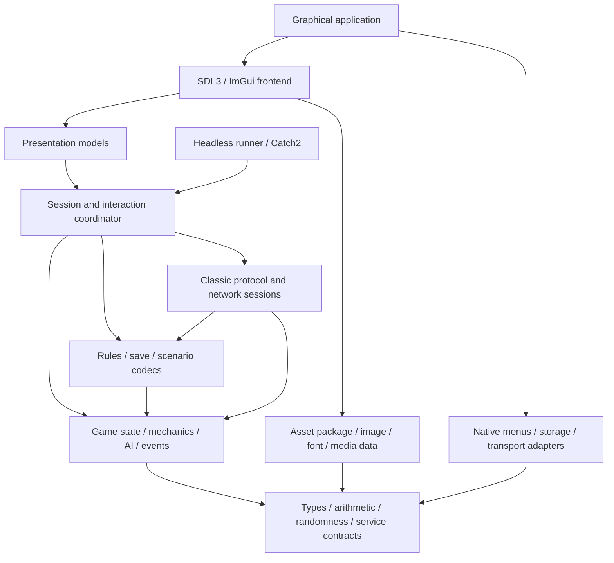

# Architecture

Status: implementation architecture, with an initial application shell integrated.
The [shell implementation](application-shell.md) records the implemented subset;
the libraries and capabilities below are the target design, not a conformance
claim. Delivery status and acceptance gates are in the
[implementation plan](implementation-plan.md).

Build a C++20 game with CMake, SDL3, and Dear ImGui for macOS, Linux, Windows,
and browser WebAssembly through Emscripten. The game implementation, including
AI, persistence, session orchestration, and networking, runs without a graphical
framework. The graphical application is one client of that implementation;
the conformance runner is another.

## 1. Cleanroom and compatibility boundary

The behavioral source of truth is this repository's
[algorithm specifications](algorithms/README.md), interpreted under
[X01](algorithms/X01-classic-compatibility-contract.md). The target is Civilization II
Multiplayer Gold Edition **5.4.0f, patch 3**. Architecture decisions cannot weaken
that contract; discrepancies must be resolved in the owning specification.

Implementation rules:

- Write new code from these specifications and their declared input formats.
  Do not read, copy, translate, link, generate from, or otherwise derive game code
  from `openciv2` or the Civ2 decompilation/reconstruction work. This includes
  their renderers, build helpers, tests, and historical execution harnesses.
  Source-navigation links in the specifications are provenance, not instructions
  for implementers to consult those sources.
- Use the original game as an external comparison and interoperability target.
  Independently authored drivers may supply inputs and capture observable state,
  files, packets, and interaction outcomes. Original executable code is never
  linked into the game or its portable tests.
- Record behavioral ambiguities as specification gaps, with the smallest
  affected operation and input domain. Obtain an original-game observation or
  clarify the specification before depending on an invented behavior. Keep
  provisional behavior and restricted prototype domains explicitly labeled.
- Each implemented operation and behavioral test cites its specification ID and
  section. Expected results distinguish specification-derived expectations,
  independent original-game captures, and implementation regression snapshots.
  A snapshot produced by our own implementation does not establish compatibility.
- General-purpose dependencies such as SDL3, ImGui, Catch2, and independent
  codecs are permitted. Record pinned versions and notices. The designated
  `PeterJohnson/openciv2-assets` runtime content is an allowed data dependency;
  its comparison tools and old-game source integration are outside the game build.

Required compatibility includes simulation, classic AI and map generation,
scenario-authored content, bidirectional original save/map/scenario interchange,
hotseat, and original-peer TCP/IP multiplayer with either engine hosting.
Presentation can change while preserving information, privacy, choices, effects,
and timing obligations. IPX, modem, serial, and original pixel/native-widget
fidelity remain optional reference work under X01.

F01 permits a new reproducible RNG policy. It does **not** permit changed
sampling laws, AI heuristics, map-generation rules, arithmetic, deterministic
ties, or rerolling a result received from another peer. Classic file/wire formats
must work without new RNG metadata.

## 2. Dependency structure

Arrows below mean “uses.” Platform implementations fulfill interfaces declared
in the portable libraries; they are selected by the executable, not constructed
by the game.

Use a small number of libraries with internal subsystem directories; the 65
specifications are ownership boundaries, not a requirement for 65 libraries.
Proposed CMake targets:

Currently implemented: `oc2_viewmodel`, `oc2_frontend`, `oc2_options`, ImGui
dependency targets, and the application/test executables. The shell lives in
`src/viewmodel/`; it contains no simulation. Add the remaining targets as their
first real operations arrive. Native menu sources currently compile into
`oc2_frontend` and can split into the listed adapter targets when needed.

| Target | Responsibility and allowed dependencies |
| --- | --- |
| `oc2_base` | Logical IDs, explicit arithmetic, sampling policy, clocks, diagnostics, service contracts; C++ standard library only initially. |
| `oc2_game` | F02 state, rule model, W/U/C/V mechanics, A01–A08, event execution; depends on `oc2_base`. |
| `oc2_formats` | F03 parsing, F06 codecs, scenario/event parsing, classic text encoding; depends on `oc2_game`. No filesystem or GUI calls. |
| `oc2_network` | N01–N03/N05 protocol state machines, encoders, synchronization and authority; depends on `oc2_game` and `oc2_formats`, injected transport/time. |
| `oc2_session` | F04/F05 orchestration, N04, setup/load flows, pending interactions, command routing and gameplay effects required by P01–P10; composes the portable game/formats/network libraries. |
| `oc2_viewmodel` | Observer-filtered map/dialog/report/menu models and frontend intent mapping; depends on portable session APIs. No SDL/ImGui types. |
| `oc2_content` | Runtime asset package, CPU image/font data, asset identities and lookup; depends on portable types and selected independent decoders. No GPU objects. |
| `oc2_frontend` | SDL window/input/render/audio and ImGui dialogs, custom drawing, map and minimap; depends on view models and content. |
| `oc2_io_native`, `oc2_io_web` | Storage, time and transport implementations. Native headless I/O must not link SDL; web glue stays out of portable libraries. |
| `oc2_menu_macos`, `oc2_menu_windows`, `oc2_menu_imgui` | Implement a shared menu contract; native handles stay in these graphical targets. |
| `openciv2`, `oc2_headless`, `oc2_tests`, `oc2_runtime_tests`, `oc2_ui_tests` | Composition roots for the game, conformance/replay CLI, portable Catch2, SDL integration tests, and ImGui Test Engine. |
| `oc2_net_bridge` | Separate native browser transport bridge; built only when requested. No game simulation. |

Keep public interfaces small and use ordinary C++20 headers and source files.
Use RAII and owned values; introduce virtual interfaces at external service
boundaries, not for every algorithm. Avoid a general ECS, plugin framework,
global service locator, or C++ modules requirement in the initial implementation.
Source-level include and CMake dependency checks enforce the graphical boundary.

## 3. State and deterministic execution

`GameState` contains logical world state, not packed classic structs. Separate
process-retained state, session state, world state, retained derived/scratch
state, and presentation-local state according to
[F02](algorithms/F02-game-state-and-invariants.md). A new game, a load, and a
process restart have different reset behavior.

Use typed civilization, unit, city, rule, and connection identities. Preserve
slot allocation, holes, scan bounds, lifetime tokens, list order, sentinels, and
retained values where specified. Do not compact pools or eagerly repair/recompute
caches. Distinguish the turn civilization, local player, viewing civilization,
human roster, and network executor. Validate a slot/token pair only where that
operation's contract calls for lifetime validation; bare classic references
retain their specified meaning.

One execution lane owns mutation for a session. The initial application runs it
cooperatively on the main thread; tests drive it directly. Background work may
read/decode immutable data or move bytes, but does not mutate game state. AI
uses the same mechanics as human play with its own specified decision and
authority paths. UI availability rules must not accidentally become AI rules.

Implement F01 conversions, signed views, wrapping, division, and rounding
explicitly. Do not depend on signed overflow, struct layout, host endianness,
unordered-container traversal, or library-specific random distributions. Disable
floating-point reassociation/fast-math where exact downstream results matter.
Use the specification's reference evaluation order until an owner-backed equivalence
argument and tests justify a change.

Provide versioned random contexts and semantic sampling sites, with separate
cosmetic randomness. The exact generator is an early implementation decision;
sampling must retain F01's biases, retries, and reused values. Tests inject
controlled logical choices; replay records complete contexts and ordered
external inputs. Frame rate and worker scheduling cannot choose which gameplay
decision receives a sample.

Classic saves and new-engine checkpoints serve different purposes. F06 codecs
preserve classic state and load transformations. A separately versioned replay
checkpoint records additional RNG/process/continuation state needed at its
supported checkpoint boundaries. Optional sidecar data is tied to the exact
classic file hash and policy version; absent or stale metadata never prevents
classic import. Define and record a fresh-context import policy in that case.

## 4. Commands, interactions, and event delivery

Portable interfaces carry semantic data, for example `MoveUnit`, `ChangeProduction`,
`OpenCity`, `ChooseTechnology`, and `ReplyToOffer`, with explicit actors and
targets. Platform events, widget IDs, and mouse pixels never enter mechanics.
Map hit testing converts pixels to W01 tile identities in the frontend.

The session coordinator resolves a command's route, authority, and current
execution checks, then invokes its owning operation. Menu availability and
execution validation remain distinct P05 contracts. Network commands distinguish
requests that execute work from messages that apply already-resolved results.
Internal AI and scenario callers retain their own admission paths.

Long-lived operations use explicit continuation/state-machine records. They can
request a decision, wait for I/O or a peer, publish an effect, or complete.
An interaction carries a stable identity, recipient, target, allowed choices,
result mapping, deadline/default policy, and continuation. A headless driver can
answer the same interaction as a dialog. Completion, cancellation, and timeout
are distinct inputs; they do not imply rollback of previously committed edits.

Service relevant incoming events at the owning specification's publication and
reentry boundaries, preserving captured values and rereading live values when
required. Do not replace all interleavings with one end-of-frame queue drain or
make every command atomic. Conversely, arbitrary paint calls do not introduce
new semantic callbacks. Revalidate pending targets according to their contracts
after deletion, ownership changes, remote results, or turn expiry.

Use SDL's callback-style application entry for the graphical shell; it fits the
browser's cooperative lifecycle. Frame work collects inputs, advances eligible
session work, obtains presentation models, and draws. Exact internal dispatch
boundaries remain the session's responsibility. Yield expensive AI/generation
work without exposing new intermediate state or admitting events at invented
boundaries. [SDL main callback documentation](https://wiki.libsdl.org/SDL3/README-main-functions)
describes the supported lifecycle.

The network service and deadlines must remain responsive during dialogs,
animations, native menu tracking, and file selection. Native menu tracking loops
need an explicit integration test and service strategy; an I/O worker alone
does not prove that protocol dispatch or deadlines remain correct. Browser
suspension is an external interruption handled through N01/N03 timeout/reconnect
rules, not a promise of background execution.

## 5. Presentation and platform menus

Use SDL3 for windowing, input, 2D rendering, and audio. Start with `SDL_Renderer`
and Dear ImGui's SDL3 platform and SDL_Renderer3 backends. The expected workload
is layered 2D assets, text, and custom dialog drawing. Prove atlas sizes, alpha,
clipping, high DPI, and browser performance in an early slice. Keep a narrow
texture/drawing boundary so a later renderer change does not reach mechanics;
do not build several renderers upfront. The upstream
[ImGui backend catalog](https://github.com/ocornut/imgui/blob/master/docs/BACKENDS.md)
documents these integrations.

Build one menu/action model with stable action IDs, labels, shortcuts, checked,
enabled, and hidden states. Retain P05's specified update semantics, including
fields a refresh leaves unchanged. Menu implementations render that model and
return an action identity through the same dispatch path.

| Platform | Main menu bar | Dialogs |
| --- | --- | --- |
| macOS | AppKit `NSMenu`, implemented in a small Objective-C++ adapter | Dear ImGui |
| Windows | Win32 menu attached to the SDL window, with native command/accelerator integration | Dear ImGui |
| Linux | Dear ImGui main menu bar | Dear ImGui |
| Browser WASM | Dear ImGui main menu bar | Dear ImGui |

Native adapters integrate with SDL's existing application/window ownership;
they do not create a second competing application loop. SDL exposes the Cocoa
window and Win32 HWND through
[window properties](https://wiki.libsdl.org/SDL3/SDL_GetWindowProperties).
Resolve command IDs and shortcut dispatch centrally so an accelerator cannot
fire once through the native menu and again through SDL. Account for macOS
application-menu conventions and the Windows menu's client-area inset.

Dialogs use ImGui for focus, input, navigation, and lifetime. Custom city panes,
maps, charts, and decorated controls use draw lists and shared textures. Every
interactive custom region also has a stable ImGui item identity and an input
target that the test engine can operate; drawing alone is insufficient.
Separate its hit testing and semantic action from its paint code. Desktop file
browsing and confirmation dialogs also use ImGui. Browser file import/export
uses a small browser capability adapter behind the ImGui flow, invoking the
browser's required file selection/download mechanism.

The renderer reads observer-filtered models rather than unrestricted world state.
W03 and N04 govern fog, remembered knowledge, diplomacy privacy, and hotseat
concealment. Clear outgoing-player views, popups, and cached presentation data
before handoff. Rendering is read-only: required recalculations historically
performed by a report or dialog move into an explicit session operation at the
same semantic boundary. Where classic logical view geometry affects gameplay
(for example V08/P07 report admission), preserve it as a declared compatibility
input independent of the new viewport and fonts.

## 6. Assets and content

Use [PeterJohnson/openciv2-assets](https://github.com/PeterJohnson/openciv2-assets),
available locally at `~/project/openciv2-assets`. Its inspected checkout was
`c4161c1843e8e06a5cf864e1633b6f6221abb797`; this is a planning observation,
not a dependency lock or a claim that a release has been downloaded.

The asset repository documents a runtime package containing `atlas-hd.pack`,
bitmap fonts, layout data, generated layout constants, provenance, and notices.
Consume this data through a newly written adapter. Document the pack/font/layout
format before writing its reader; an undocumented field is a content-contract
gap, not permission to consult the old renderer. Prefer data contracts and
locally generated typed tables over incorporating another game's headers or
resolver code. A generated constants header is eligible only as reviewed
data-only asset output. See the asset repository's
[runtime package guide](https://github.com/PeterJohnson/openciv2-assets/blob/c4161c1843e8e06a5cf864e1633b6f6221abb797/docs/ASSET-DEPENDENCIES.md).

The build accepts an explicit asset directory or pinned release archive/hash.
Use `OC2_ASSETS_DIR` as the CMake cache setting; a developer preset can point to
the sibling checkout. Invalid explicit paths fail clearly. A source checkout
can use its standalone runtime pack builder; run no review/comparison pipeline
and require no `openciv2` checkout or original executable. CI/release builds
consume immutable runtime packages with checked inventory and checksums. Pure
game tests need only small owned fixtures and do not build the graphics pack.

Expose semantic `AssetId`s and metadata for dimensions, anchors, sheets, palettes,
and versions; GPU texture handles belong only to the frontend. Preserve P03/F03
resource lookup and scenario override precedence. Decode supported classic
custom graphics independently, retaining sheet identity, marker/palette and
transparency meaning. The HD stock package must not silently replace authored
scenario graphics. S04 exports remain classic-compatible.

Graphics do not supply the complete game content set. F03 explicitly treats
rule tables as external input, and P04/P08 require text resources. Inventory and
provenance for stock rules, labels, Civilopedia text, and scenario fixtures are
early delivery dependencies. Use small authored fixtures for initial tests;
do not assume the specs contain a full distributable stock data set or obtain
one from reconstruction source. Keep user-supplied classic data and any separately
approved distributable content clearly identified.

The current asset dependency supplies graphics; stock sound can be added there
later. Reserve audio/media identities and manifest versioning now, with an SDL
audio implementation and a silent test backend. Missing stock cosmetics can
have explicit fallback; supported authored WAV/video requests, meaningful
notices, and completion/cancel semantics remain P10 obligations. Select
independent media decoders against that domain before claiming scenario support.
Do not let missing media, a browser audio permission, or a skipped animation
suppress a game effect or required reply.

## 7. Persistence and networking

Classic codecs read/write explicit field widths, little-endian values, strings,
and retained bytes. They never dump C++ objects. Keep file bytes, N02 state
images/diffs, and transport frames as separate formats even where fields overlap.
Storage adapters provide byte I/O and failures; the portable operation owns
publication and partial effects. Validation and staged writes are useful only
where they preserve the admitted F03/F06 failure contract; blanket transactional
load/save behavior would be incorrect.

Implement N01–N03 as portable state machines and N05 as incremental framing,
routing, and discovery logic over replaceable stream/datagram services. Native
adapters use nonblocking TCP/UDP; fake adapters supply fragmentation, coalescing,
backpressure, loss, clocks, disconnects, and late replies. Preserve the original
per-operation authority model, section encodings/checksums, message order,
barriers, join/resume, and host transfer. A new host-authoritative or deterministic
lockstep protocol would not satisfy X01.

Browsers cannot directly connect to arbitrary TCP sockets; WebSockets and proxy
services are the relevant Emscripten mechanisms. See
[Emscripten networking](https://emscripten.org/docs/porting/networking.html).
The planned browser path is an explicit WebSocket-to-native transport bridge:

- The original peer speaks unchanged classic TCP/UDP; install nothing in it.
- The bridge carries transport bytes/events and discovery results, not gameplay
  decisions. Application encodings and authority remain N01–N05's.
- Hosting requires a reachable native listener at the bridge. UDP discovery
  sees the bridge's network, not the browser's LAN. Address/connection identity,
  reconnect, and host migration must be demonstrated in both directions.
- Scope bridge access to configured sessions/endpoints with authentication and
  bounded resources; it must not become an unrestricted public socket proxy.

Native mixed-peer support is a baseline release gate. Browser local play can
ship as an explicitly limited preview while the bridge is built. Full browser
multiplayer claims require bridge-backed interoperability evidence; do not
silently reinterpret WebSockets as native TCP/UDP or declare the gap optional.

For browser storage, stage imports and asset reads in a virtual filesystem and
persist saves/preferences through IndexedDB-backed storage with explicit flush
completion and export/download. Never report a durable save before persistence
succeeds. The
[Emscripten filesystem API](https://emscripten.org/docs/api_reference/Filesystem-API.html#filesystem-api-idbfs)
documents IDBFS synchronization. Desktop and browser path adapters must preserve
classic resource-name lookup without depending on host case sensitivity.

## 8. Build, tests, and delivery

Use target-based CMake with `cxx_std_20`, extensions disabled, and separate build
directories per native or Emscripten toolchain. Enable Objective-C++ only for the
macOS adapter. Commit portable presets for debug, release, sanitizers, headless,
and web; keep machine paths in untracked user presets. Record exact dependency
and emsdk versions in [dependencies.json](../dependencies.json), updating the
tested set together.
Use pinned FetchContent inputs or explicit compatible installed packages,
with downloads opt-in and cached/offline operation supported. Never track a
dependency's moving branch as a reproducible build input.

Keep graphical, test-engine, original-comparison, and bridge dependencies opt-in.
`OC2_BUILD_GUI=OFF` must configure and run Catch2/conformance tests without SDL,
ImGui, graphics assets, display servers, or an original installation. Runtime
packaging carries only the selected data, application, and dependency notices.
macOS app bundles, Windows packages, Linux packages, and web JS/WASM/data outputs
are produced from the same source and locked content inputs.

Catch2 v3 owns unit and portable integration tests. CTest groups fast mechanics,
formats, replay, network, UI, and external interoperability suites. Use native
test discovery there; cross-compiled WASM tests need an explicit JS/browser
runner rather than executing a target binary during CMake configuration.

Implement the existing X02 version 3 fixture format and its operation/state
registry, controlled-choice and implementation-replay modes, dependency-aware
trace comparison, provenance, and coverage ledger. Start with the three fixtures
already in `docs/algorithms/conformance/`. Missing scripted inputs fail; they
never fall back to random values or real clocks. Hash explicit logical state,
not native object memory. Separate regression evidence from original-game
interoperability and optional original-presentation comparisons.

Use ImGui Test Engine for dialogs, menus, custom item interactions, focus,
keyboard routing, accept/cancel, and changing targets. Catch2 checks the same
portable view models and command semantics. Native menu behavior also needs
platform adapter tests and real desktop smoke tests; ImGui tests cannot validate
AppKit or Win32 menus. Visual regression images of our UI supplement semantic
checks, with original screenshots used only as optional comparisons.

Pin ImGui and its test engine as a tested pair. The test engine has its own
[license](https://github.com/ocornut/imgui_test_engine/blob/main/imgui_test_engine/LICENSE.txt);
record its notice and applicable terms separately from ImGui's MIT license,
and keep test instrumentation out of release builds.

CI covers Linux GCC/Clang, macOS AppleClang, Windows MSVC, and pinned Emscripten.
Run portable arithmetic/replay vectors across native and WASM builds, sanitizers
on suitable native jobs, decoder/protocol fuzzing, browser smoke tests, and
display-backed UI tests. Original-game file/peer tests use separately provisioned
external runs with executable identity and capture provenance. Their absence
leaves an explicit conformance gap; passing cleanroom-only tests cannot close it.
